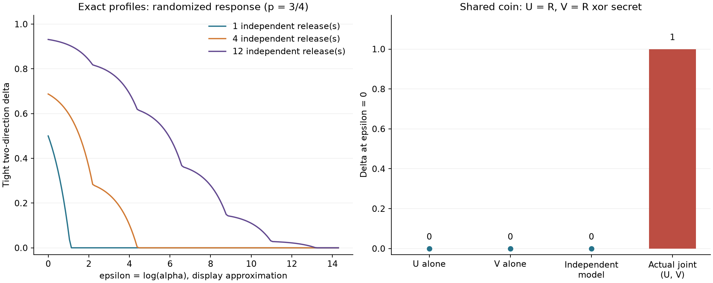

# Finite channel privacy

**Repeated releases accumulate privacy loss, and their joint distribution
matters.** This project computes exact privacy profiles for finite output
laws, composes conditionally independent releases, and finds the smallest
privacy multiplier satisfying a chosen delta. It also constructs a shared-coin
example in which both individual releases hide a bit but their joint output
reveals it completely.

The core uses Python `Fraction`, returns worst-event witnesses, handles zero
probabilities explicitly, and never rounds likelihood ratios into buckets.
Separate exhaustive event and transcript calculations check the results.
All channels are synthetic mathematical examples; no personal data is used.

**Scope:** the two rows supplied to the tool describe one specified neighboring
input pair. Exact analysis of those rows does not establish privacy for other
input pairs, a learned probability estimate, or an unverified implementation.



## Reproduce

Python 3.11 or newer:

```bash
git clone https://github.com/lcx0731/finite-channel-privacy.git
cd finite-channel-privacy
python3 -m venv .venv
source .venv/bin/activate
python -m pip install ".[test]"
python -m pytest -W error
PYTHONWARNINGS=error privacy-demo --output results
python -m pip check
```

The demo writes `results/summary.json`, `results/rr-channel.json`, and
`results/privacy-profiles.png`. It checks full transcript distributions of
sizes 2, 16, and 4,096, plus all 256 event subsets of a three-release experiment.
It requires no external dataset or network after installation.

For the recorded CPython 3.13.0 environment, use a fresh environment with:

```bash
python -m pip install -r requirements-repro.txt
python -m pip install --no-deps .
python -m pytest -W error
PYTHONWARNINGS=error privacy-demo --output reproduced-results
cmp results/summary.json reproduced-results/summary.json
```

The dependency snapshot is not a cross-platform or hash lockfile. JSON results
are deterministic and contain exact rational strings. The chart uses decimal
display coordinates and connects exact evaluations on a rational alpha grid;
rendering can vary by platform. CI tests Python 3.11 and 3.13.
The core API and CLI have no third-party runtime dependencies. The `test` extra
adds pytest and matplotlib for verification and the figure.

## What is being computed?

Let $P$ and $Q$ be the output distributions under two neighboring inputs.
For $\alpha=e^\varepsilon\geq1$, define

$$
H_\alpha(P,Q)=\max_E\{P(E)-\alpha Q(E)\}
=\sum_y[P(y)-\alpha Q(y)]_+.
$$

The tight delta for **both** directions of this pair is

$$
\delta(\alpha)=\max\{H_\alpha(P,Q),H_\alpha(Q,P)\}.
$$

The maximizing forward event contains precisely outputs with
$P(y)>\alpha Q(y)$; the reverse event swaps the two laws. The result records
both events and both directional values, because the directions can differ.
At $\alpha=1$, delta equals total variation distance.

For a binary input domain whose sole neighboring pair is the supplied pair,
this gives its differential-privacy profile. A larger domain requires checking
every relevant pair or independently proving a valid dominating bound.
The program does not supply such a proof or infer an adjacency relation.

### Exact multiplier calibration

`channel.calibrate(target_delta)` returns the smallest rational
$\alpha\geq1$ with $\delta(\alpha)\leq\delta_{target}$.
Each directional curve is piecewise linear in alpha. The implementation sorts
its rational likelihood-ratio breakpoints, tracks the active intercept and
slope, and solves the relevant line exactly. The two directional requirements
are then combined by taking the larger multiplier.

Mass on outputs possible under only one input creates an irreducible delta:

$$
\delta_{floor}=\max\left\{
\sum_{y:Q(y)=0}P(y),\quad\sum_{y:P(y)=0}Q(y)
\right\}.
$$

Targets below this floor return `None` (`null` in JSON), meaning no finite
multiplier can meet the target. A target of zero requests a pure-DP multiplier.
Targets already met at alpha one return exactly one.

Using rational alpha avoids treating a rounded evaluation of `exp(epsilon)`
as exact. The associated epsilon is mathematically `log(alpha)`; decimal
epsilon values below are display approximations, not replacement certificates.
Arbitrary irrational multipliers and continuous output laws are outside scope.

## Independent composition and exact compression

`compose_independent` takes conditional product laws for the **same** binary
input. At every step it groups outputs with exactly equal $P(y)/Q(y)$,
preserving both their total P mass and total Q mass. Equal ratios have the
same sign in every hockey-stick summand, so grouping preserves all profiles
and all calibrated budgets.

The grouping uses rational equality. Singular states with positive P mass
and zero Q mass form one bucket; states impossible under both inputs are
dropped. Products are formed from the two masses directly, avoiding an
undefined `0 * infinity` likelihood-ratio operation.

After compression, output indices and event witnesses refer to **ratio
buckets**, not to original output symbols. The CLI includes both bucket
probability rows so the event witnesses can be checked. The buckets do not
provide a generative simulator for the original transcript or preserve
arbitrary downstream utility statistics.

For $n$ identical randomized-response releases, only $n+1$ ratios remain,
instead of storing $2^n$ binary transcripts. Heterogeneous channels can still
produce exponentially many distinct ratios; this reduction is not universal.

The default caps are 100,000 ratio states and 1,000,000 cumulative pair
multiplications. Exceeding a cap raises an error, with no approximate or partial
privacy answer. These limits do not bound input file size or integer bit
complexity. Empty composition is a constant output and has alpha one, delta zero.

## Synthetic results

Randomized response reports a binary secret truthfully with probability 3/4:

```json
{"p": ["3/4", "1/4"], "q": ["1/4", "3/4"]}
```

For independent repetitions of this channel, the recorded exact results are:

| Releases | Raw transcripts | Ratio states | Delta at alpha 1 | Minimum alpha for delta 0.01 | Epsilon, approximately |
| ---: | ---: | ---: | ---: | ---: | ---: |
| 1 | 2 | 2 | 1/2 | 74/25 | 1.085189 |
| 4 | 16 | 5 | 11/16 | 1961/25 | 4.362334 |
| 12 | 4,096 | 13 | 488293/524288 | 9091721/25 | 12.803999 |

The pure-DP multipliers are $3^n$: 3, 81, and 531,441, respectively.
The 12-release product uses 156 pairs of compressed states across its steps.
This is operation accounting, not a measured speed or memory benchmark.
These example parameters are not recommended privacy budgets.

### Output postprocessing

`channel.postprocess(kernel)` applies the same stochastic output transformation
under both inputs. Tests verify that this cannot increase the computed delta.
The kernel must not depend on the private input through additional information.

For three independent releases, releasing only their majority vote changes the
pure multiplier from 27 to 27/5. At alpha 9, the full transcript has delta 9/32,
while the majority output has delta zero. This illustrates a property of the
specified probability tables; the project does not quantify the associated
utility tradeoff or implement a private production release.

### Shared randomness: why the marginals are insufficient

Let $R$ be one fair random bit, independent of the binary secret $S$, and release
$U=R$ and $V=R\mathbin{\mathrm{xor}}S$. Both U and V alone have the same uniform
distribution under either secret. Their marginal profiles have delta zero
at alpha one.

But the joint outputs, ordered `00, 01, 10, 11`, have laws

| Secret | 00 | 01 | 10 | 11 |
| --- | ---: | ---: | ---: | ---: |
| 0 | 1/2 | 0 | 0 | 1/2 |
| 1 | 0 | 1/2 | 1/2 | 0 |

Their supports are disjoint, and $S=U\mathbin{\mathrm{xor}}V$. Consequently the
joint delta is **one for every finite alpha**. Multiplying the two uniform
marginals instead gives a constant privacy profile of zero, but models a
different joint law.

This does not contradict sequential DP composition: conditional on U, the
second release reveals the secret and lacks the claimed conditional guarantee.
The exact product API requires conditional independence; it cannot discover
whether a real system reused randomness from its marginal tables alone.

## CLI and API

```bash
privacy-audit results/rr-channel.json --releases 4 \
  --alpha 9 --target-delta 1/100
```

The CLI accepts exactly `p` and `q` arrays. Entries are integers or rational /
decimal **strings**, such as `"3/4"` and `"0.75"`. JSON floating-point numbers,
booleans, duplicate fields, invalid probabilities, and unnormalized rows are
rejected. CLI alpha and delta arguments also accept exact decimal strings.
Releases must be between zero and 100. Other resource caps use API defaults.

The JSON contains directional profiles and witnesses, the minimum alpha,
singular delta floor, and the compressed probability table. Exact quantities
are strings, while indices and counts remain integers. Input files are never
edited. Invalid input exits 2 with an explanation on stderr.

```python
from fractions import Fraction
from finite_privacy import compose_independent, randomized_response

rr = randomized_response(Fraction(3, 4))
experiment = compose_independent([rr] * 4)
alpha = experiment.channel.calibrate(Fraction(1, 100))
assert alpha == Fraction(1961, 25)
assert experiment.channel.profile(alpha).delta == Fraction(1, 100)
assert len(experiment.channel.p) == 5
```

Core APIs accept integers and `Fraction` objects; floats and booleans are
rejected. Channel objects are immutable. The analysis consumes specified
probabilities, not observations drawn from a mechanism.

## Verification and limitations

The 70 tests include exhaustive event inequalities for profiles and calibration,
binomial randomized-response formulas, full transcript enumeration, asymmetric
directions, zero and singular masses, exact breakpoint ties, rational gaps
smaller than floating-point resolution, heterogeneous products, compression
invariance, stochastic postprocessing, shared randomness, resource caps, strict
input rejection, CLI behavior, and deterministic demo reproduction.

The event oracle enumerates all subsets and maximizes their signed probability
differences. Its calibration oracle solves each subset's inequality separately.
Neither uses the main breakpoint sweep. The transcript reference explicitly
enumerates tuples without likelihood-ratio compression. Both references have
small-input limits and are intended for verification, not large accounting runs.

For a channel with m output states, a profile needs O(m) rational operations
and calibration needs O(m log m) sorting. A composition step with a and b
current/input ratio states evaluates ab pairs and sorts the resulting groups.
Rational numerator and denominator sizes affect runtime and storage. The JSON
CLI loads the whole input table; composition also records state counts per step.

This is a finite-table educational audit, with no continuous-mechanism
discretization, subsampling amplification, adaptive-channel proof, adjacency
enumeration, empirical-distribution uncertainty, or production RNG validation.
Do not interpret a fit to sampled outputs as a mathematical DP guarantee.

## References and attribution

- Dwork and Roth, [The Algorithmic Foundations of Differential Privacy](https://www.cis.upenn.edu/~aaroth/Papers/privacybook.pdf),
  for differential privacy, randomized response, postprocessing, and composition.
- Google Differential Privacy Team,
  [Privacy Loss Distributions](https://github.com/google/differential-privacy/blob/8536a3af6b147b1cce6f884826bfd5f2009ae50f/common_docs/Privacy_Loss_Distributions.pdf),
  for hockey-stick divergence and probability-law accounting terminology.
- Doroshenko et al., [Connect the Dots: Tighter Discrete Approximations of Privacy Loss Distributions](https://petsymposium.org/popets/2022/popets-2022-0122.php),
  for broader context on privacy-loss representations. This project uses exact
  finite rational tables and does not implement that paper's approximation method.

The ideas are established. The implementation, fixtures, and tests were written
for this repository; no novelty or production privacy certification is claimed.
Released under the [MIT License](LICENSE).
